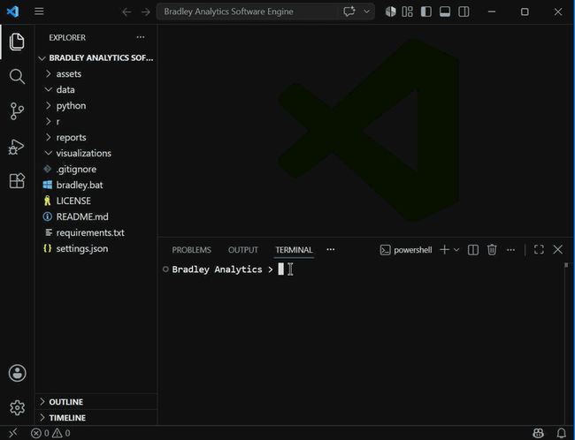

<h1 class="group-title" id="overview">Overview</h1>

<a id="overview-section"></a>

## Overview

Bradley Analytics is a free NBA analytics platform built by one person, Alex Bradley: a website with live game windows that follow every NBA game as it happens, and a full analytics dashboard that turns any player, team, lineup or season since 1996-97 into professional, interactive visualizations.

It has three parts that work together:

- **The website** (bradley-analytics.com) — live windows for every game of the night, built straight from the NBA's live play-by-play in your browser, with the dashboard embedded right below them.
- **The dashboard** — every Search, chart and tool in one place: shot charts to lineup networks, a league-wide criteria search, front office and coaching tools, an AI assistant, and a way to analyze your own team's stats.
- **The engine** — the original Python and R command-line software that the project started as, still in the repository, generating publication-ready charts from the NBA's data.

Everything is built on real NBA data, updated live, and every chart is interactive: hover over it on a computer, or hold and run your finger over it on a phone, to see the numbers behind any point.

### Why This Matters

Front offices, coaches, scouts and media all lean on visuals like these to see what a box score can't: where a player scores from, which lineups actually work, how a game swung, what a contract does to a cap sheet. Those tools usually sit behind team walls or paid subscriptions. Bradley Analytics puts the same kind of analysis in front of anyone, for free, and makes it fast to read: one click from a question to a chart.

It's also built to grow past the NBA. Coaches and players at any level can upload their own stats and get the same analysis, which is the foundation for bringing professional-grade analytics to youth basketball.

And it's a working portfolio of the full analytics pipeline: pulling live data from public APIs, cleaning and modelling it, inventing new metrics, designing the visuals, and shipping it all as a product people use every night.

Portfolio:  
[Bradley Analytics Instagram](https://www.instagram.com/bradleyanalytics/)

---

<a id="features-section"></a>

## Features

### Live Game Windows

Every game of the night, as it happens, on the website's home page (one tap on **Full screen** shows every window at once), with **Live Leaderboards** under them:

- **Live Game** — the score, quarter by quarter, the lead through the game, lead changes and time ahead
- **Shot Chart** — every shot replayed in order, for one player, one team or both
- **Player Card** — a player's full line and his points through the game
- **Team Comparison**, **Win Probability** and **Box Score** (sortable by any column)
- **Lineup Network** — how the five on the floor have played together, this game or this season
- **Assist Web** — who assisted whom, live
- **Hot Hand**, **Leaderboard**, **Injury Report** and **All Games**, with every game day of the season one click away
- **Live Leaderboards** — players and teams: the leaders (the Bradley 3PT Rating first), every season average, and the standings

Every graph in them answers the pointer: hover for the lead at any moment, a shot's details, a pair's net rating or who a player assisted.

### Search by Player and Search by Team

Pick any player or team and any season since 1996-97, then choose from 18 visualizations:

- **Court charts** — Shot Chart, Heat Map, Hex Shot Chart, Passing Web and Animated Shot Chart
- **Advanced charts** — Season Trend Chart, Archetype Radar Chart, Clutch Impact Clock, Career Combo Chart, Scoring Splits Waterfall Chart, League Comparing Tornado Chart, Calendar Heat Map and Shot Flow (Sankey)
- **League comparison charts** — Bar Chart, Scatter Plot, Multi-Season Slope Chart, League Average Histogram, Box Plot and Cumulative Percentile Plot

### Search by Criteria

Search the whole league instead of one player:

- **Stats** — filter by age, height, salary and any combination of stats, then see the result as a scatter plot
- **Lineups** — every 2, 3, 4 or 5-man lineup in the league, filtered by minutes together and any lineup stat, as a lineup network
- **Shots by area** — circle any spot on the court and see every player who shoots well from there
- **Passing** — the players who set up (or finish) assisted baskets from any kind of shot, as passing webs

### On/Off Lineup Network

Every combination of teammates who shared the court this season, connected and colored by that group's net rating, and how a team's numbers shift with any two or three players on the floor together.

### Front Office and Coaching

- **Front Office** — a team's roster (with stats, Bradley Ratings or tendencies), salary cap sheet, trade machine and an in-depth guide to the CBA showing where that team stands, with draft scouting and staff on the way
- **Coaching** — plan a rotation with a minutes slider for every player against a 240-minute game, and study every player's tendencies, with a playbook and film room on the way

### AI Search

Ask anything about basketball — stats, comparisons, history, rules — or about the dashboard itself, and get an answer with a link straight to the right chart or tool.

### Build, Share and Bring Your Own Data

- **Stat Formula Creator** — invent your own stat from any weighted mix of real stats and rank the league by it
- **Tableau Dashboard** — combine up to six charts into one collage
- **Community Uploads** — share charts and browse everyone else's
- **Upload Stats** — upload a player's shots, a team's box scores or a whole league (CSV or Excel) and get the same analysis the dashboard runs on NBA data; files stay private to your session
- **Glossary** — every stat and chart, defined in one place

### Bradley Analytics Invented Stats

Original 0-100 ratings built from real NBA data:

- **Bradley 3-Point Shooting Rating** — blends shooting percentage (adjusted for how many shots it's built on) and three-point volume, each ranked against the league, across the current season and recent history, with smooth adjustments for one-off bad seasons and long-term consistency
- More Bradley ratings are on the way

### Interactive, Downloadable Charts

Every chart shows the numbers behind each point in a pop-up. Keep any pop-up on screen (hold ctrl and click on a computer; lift your finger on a phone), drag it anywhere, and download the chart as a PNG with your pop-ups in it.

---

<a id="how-it-works-section"></a>

## How It Works



### Architecture Diagram

```
                     bradley-analytics.com
            (GitHub Pages: HTML, CSS and JavaScript)
                  |                          |
                  v                          v
     Live game windows             The dashboard (embedded)
   ESPN's public live feed,      Streamlit app in Python
   read in the visitor's             |
   browser every few seconds         v
                              NBA stats API (nba_api)
                              + Bradley data files
                              (ratings, salaries, rosters)
                                     |
                                     v
                         Data processing (pandas, numpy)
                                     |
                                     v
                    Charts (matplotlib) + interactive layer
                   (hover / hold pop-ups, pins, PNG export)
```

### Workflow

```
1. A visitor opens the website
                |
                v
2. The live windows load tonight's games straight from
   ESPN and follow them play by play
                |
                v
3. In the dashboard, they pick a player, team or criteria
   and a visualization
                |
                v
4. Python pulls the NBA data and cleans it
                |
                v
5. The chart is drawn, made interactive, and shown --
   ready to hover, pin, share or download
```

The original command-line engine follows the same path with R at the end: Python gathers the data, and R (ggplot2) draws a shot chart, heat map, hex chart, bar chart, scatter plot or animated shot chart as a PNG or GIF.

---

<a id="technologies-used-section"></a>

## Technologies Used

### Programming Languages

- Python
- R
- JavaScript, HTML and CSS

### Data

- NBA stats API (nba_api)
- ESPN's public live game feed
- pandas and numpy

### Visualization

- matplotlib (the dashboard's charts)
- ggplot2, tidyverse, hexbin, ggfx, ggimage, scales and gifski (the engine's charts)
- SVG and HTML canvas (the website's live windows and banner)

### App and Website

- Streamlit (the dashboard)
- Jekyll and GitHub Pages (the website)
- Groq (AI Search)

### Development Tools

- Visual Studio Code
- Git and GitHub

### Analytics Skills Applied

- Data collection from live APIs
- Data cleaning and modelling
- Statistical visualization and dashboard design
- Inventing and validating new metrics
- Sports analytics storytelling
- Basketball performance, lineup and salary cap analysis

---

<a id="project-structure-section"></a>

## Project Structure

```
Bradley Analytics Software Engine/
│
├── streamlit/              The dashboard
│   ├── app.py              every page of the dashboard
│   ├── visuals.py          every chart
│   ├── interactive.py      the charts' pop-ups, pins and downloads
│   ├── hotspots.py         what each part of a chart shows
│   ├── nba_data.py         NBA data, cached
│   ├── ai_search.py        AI Search
│   ├── criteria_tools.py   Search by Criteria
│   ├── upload_stats.py     Upload Stats
│   ├── cba_guide.py        the CBA guide
│   └── ...                 teams, pickers, salary table and more
│
├── docs/                   The website (bradley-analytics.com)
│   ├── index.html          Home: live tape, windows and leaderboards, dashboard, video
│   ├── games.html          Games, and games/blacktop/ (Blacktop 1v1)
│   ├── portfolio.html      Portfolio
│   ├── consulting.html     Consulting
│   ├── overview.md         this page
│   ├── author.md           Author
│   └── assets/             live windows, banner, scripts and images
│
├── python/                 The original engine (Python)
├── r/                      The original engine's charts (R)
├── data/                   Ratings, tendencies, rosters and salaries
├── scripts/                Live-window backup data and keep-alive
├── ai_assistant/           AI Search's instructions and tools
├── reports/                Bradley Analytics reports
├── assets/                 README images and banner
├── worker/                 Live game notifications (Cloudflare Worker)
│
├── README.md
├── LICENSE
├── requirements.txt
├── settings.json
└── bradley.bat
```

---

<h1 class="group-title" id="installation">Installation</h1>


<a id="setup-section"></a>

## Setup

### Clone the Repository

```bash
git clone https://github.com/alexbrxdley/Bradley-Analytics-Software-Engine.git
```

Navigate into the project folder:

```bash
cd "Bradley Analytics Software Engine"
```

### Install Python Dependencies

```bash
pip install -r requirements.txt
```

### Install Required R Packages

The engine uses R for generating visualizations. Make sure R is installed locally before running the software.

Open R and install the required packages:

```r
install.packages("tidyverse")
install.packages("ggplot2")
install.packages("hexbin")
install.packages("ggfx")
install.packages("ggimage")
install.packages("scales")
install.packages("jsonlite")
install.packages("gifski")
```

---

<a id="usage-section"></a>

## Usage

Launch the Bradley Analytics Software Engine:

**Windows:**

```bash
.\bradley.bat
```

**Mac:**

```bash
python3 python/bradley_analytics.py
```

The engine will guide you through:

1. Searching by player or team
2. Choosing a visualization (Court Graphs, Axis Graphs, or Animated)
3. Court Graphs and Animated: entering a player/team and season
   Bar Chart: choosing a stat, how many to show, season, and orientation
   Scatter Plot: choosing two stats (Y axis, then X axis), how many to show, and season
4. Selecting an accent color (team name or a color code), every visualization except Scatter Plot, which shows no color at all (images only)

Shot Chart Example:

```
Search by player, team or criteria
1. Player
2. Team
3. Criteria

Choose an option: 1

Available Visualizations

Court Graphs:
1. Shot Chart
2. Heat Map
3. Hex Shot Chart

Axis Graphs:
4. Bar Chart
5. Scatter Plot

Animated:
6. Animated Shot Chart

Choose visualization: 1

Enter player name: Jayson Tatum

Available Seasons

1. 2017-18
2. 2018-19
3. 2019-20
4. 2020-21
5. 2021-22
6. 2022-23
7. 2023-24
8. 2024-25
9. 2025-26

Choose season: 9

For visualization color, enter team name or a color code: Celtics

Accent color: #007A33
```

Bar Chart (option 4) follows a different order after it's selected: it asks for a stat, how many entities to show, season, and orientation, before finishing with the same accent color prompt.

Scatter Plot (option 5) follows a different order too: it asks for a first stat (Y axis), then a second stat (X axis), how many entities to show, and season, with no orientation and no color prompt at all (the chart uses player headshots or team logos, not a colored fill). Both stat prompts share the same categorized picker, with Bradley Analytics' own invented ratings listed first.

Animated Shot Chart (option 6) follows the exact same player/team and season flow as the Court Graphs above, just kept in its own category so it's not confused with the static charts.

The engine will automatically:

- Retrieve NBA data using the NBA API
- Process it for the selected visualization
- Generate the chart using Python and R
- Save the final PNG file (or GIF, for Animated Shot Chart)

Generated visualizations are saved in:

```
visualizations/
```

---

<a id="customization-section"></a>

## Customization

Every tunable value across every visualization: colors, sizes, shadow effects, minimum-attempts qualifiers, and more, all live in one file at the project root:

```
settings.json
```

Open it in any text editor, change a value, save, and run the engine again, no code changes needed. Settings are grouped by which visualization they affect (`shot_chart`, `heat_map`, `hex_shot_chart`, `animated_shot_chart`, `bar_chart`, `scatter_plot`), plus `bradley_ratings` for the formula behind every Bradley Analytics invented stat, and shared sections for colors, output dimensions, and data-fetching behavior (like `min_games_played`, which filters out small-sample-size players from Bar Chart and Scatter Plot leaderboards).

---

<a id="example-output-section"></a>

## Example Output

Example generated files:

```
visualizations/

jayson-tatum_2023-24_shot-chart.png
jayson-tatum_2023-24_heat-map-chart.png
jayson-tatum_2023-24_hex-shot-chart.png
top-10-bradley_3pt_rating_2025-26_bar-chart.png
top-10-bradley_3pt_rating-vs-3pa_2025-26_scatter-plot.png
jayson-tatum_2023-24_animated-shot-chart.gif
```

These visualizations can be used for:

- Player evaluation
- Scouting reports
- Social media analytics
- Basketball strategy discussions
